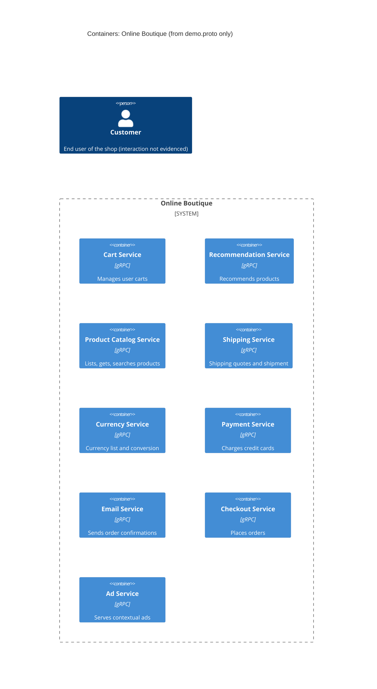

# Task 1A: Recovered architecture (C4 container level)

## 1. Agent

Claude Code (Anthropic), model Claude Opus 5.5 (`claude-opus-5-5`).

## 2. Files read

- `prompts/1-recover-architecture.md` (task file)
- `system/online-boutique/protos/demo.proto` (only evidence)

## 3. Containers table

All services are declared in `package hipstershop` (`demo.proto` line 17). The proto defines the gRPC interfaces only. It does not show what language implements each service.

| Name | Technology / language | Responsibility | Evidence |
|---|---|---|---|
| Cart Service | gRPC service (language not evidenced) | Adds items, gets and empties a user's cart (`AddItem`, `GetCart`, `EmptyCart`) | `system/online-boutique/protos/demo.proto` (`service CartService`, l.23–27) |
| Recommendation Service | gRPC service (language not evidenced) | Returns recommended product IDs for a user and a list of products (`ListRecommendations`) | `demo.proto` (`service RecommendationService`, l.56–58) |
| Product Catalog Service | gRPC service (language not evidenced) | Lists, gets and searches products (`ListProducts`, `GetProduct`, `SearchProducts`) | `demo.proto` (`service ProductCatalogService`, l.71–75) |
| Shipping Service | gRPC service (language not evidenced) | Quotes shipping cost and ships orders, returning a tracking ID (`GetQuote`, `ShipOrder`) | `demo.proto` (`service ShippingService`, l.107–110) |
| Currency Service | gRPC service (language not evidenced) | Lists supported currencies and converts money (`GetSupportedCurrencies`, `Convert`) | `demo.proto` (`service CurrencyService`, l.140–143) |
| Payment Service | gRPC service (language not evidenced) | Charges a credit card, returning a transaction ID (`Charge`) | `demo.proto` (`service PaymentService`, l.177–179) |
| Email Service | gRPC service (language not evidenced) | Sends order confirmation emails (`SendOrderConfirmation`) | `demo.proto` (`service EmailService`, l.199–201) |
| Checkout Service | gRPC service (language not evidenced) | Places an order and returns an `OrderResult` (`PlaceOrder`) | `demo.proto` (`service CheckoutService`, l.224–226) |
| Ad Service | gRPC service (language not evidenced) | Returns ads for page context keys (`GetAds`) | `demo.proto` (`service AdService`, l.243–245) |

Data stores: Not evidenced in the provided files.

## 4. Dependencies table

A `.proto` file declares which interfaces each service **offers**. It does not say who **calls** them. So no caller → callee dependency is evidenced.

| Caller → callee | Protocol | Evidence |
|---|---|---|
| *(none evidenced)* | — | Not evidenced in the provided files |

## 5. Mermaid diagram

The diagram matches the tables: the 9 containers and no `Rel` lines, because no dependency is evidenced. The `Person` is included because the template requires one. Its relationship to the system is not evidenced (see Gaps).

## 6. Gaps

| Gap | Why it is unresolved | Extra file that would settle it |
|---|---|---|
| Caller → callee dependencies | The proto shows interfaces only, not clients | `system/online-boutique/kubernetes-manifests/*.yaml` (`*_SERVICE_ADDR` env vars), or each service's source code |
| **[Inferred]** Checkout Service calls Cart, Product Catalog, Currency, Shipping, Payment and Email | `PlaceOrderRequest` carries `CreditCardInfo` (also used by `ChargeRequest`) and `Address` (used by `ShipOrderRequest`). `OrderResult` contains `shipping_tracking_id` (returned by `ShipOrder`) and is the payload of `SendOrderConfirmationRequest`. The shared message types suggest these calls, but they do not prove them | `kubernetes-manifests/checkoutservice.yaml`, checkout service source |
| Frontend / web UI container and how the Customer reaches the system | No frontend service or HTTP interface in the proto. The Customer must reach the system somehow, but how is not shown | `kubernetes-manifests/frontend.yaml`, frontend source |
| **[Inferred]** A UI calls Ad, Recommendation, Catalog, Currency, Cart and Checkout | These RPCs (e.g. `AdRequest.context_keys` "from the current page", l.248) look aimed at page rendering, but no caller is declared | `kubernetes-manifests/frontend.yaml` |
| Implementation language of each service | Proto is language-neutral (only `go_package` option, l.19, which is for generated Go code, not proof the services are written in Go) | Each service's `Dockerfile` or source folder under `system/online-boutique/src/` |
| Data stores (e.g. where carts are stored) | No database or cache appears in the proto | `kubernetes-manifests/cartservice.yaml`, any Redis/DB manifest |
| External systems (real payment gateway, real email/SMTP) | Not evidenced in the provided files | Payment and email service source, manifests |
| Message brokers / async communication | Only unary RPCs are declared. No broker is evidenced | Kubernetes manifests |
