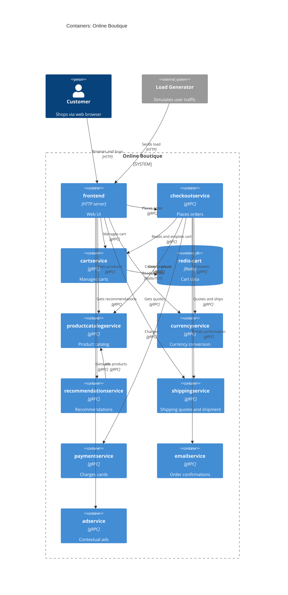

# Task 1B: Recovered architecture (C4 container level)

## 1. Agent

Claude Code (Anthropic), model Claude Opus 5.5 (`claude-opus-5-5`).

## 2. Files read

- `prompts/1-recover-architecture.md` (task file)
- `system/online-boutique/protos/demo.proto`
- `system/online-boutique/kubernetes-manifests/README.md`
- `system/online-boutique/kubernetes-manifests/kustomization.yaml`
- `system/online-boutique/kubernetes-manifests/adservice.yaml`
- `system/online-boutique/kubernetes-manifests/cartservice.yaml`
- `system/online-boutique/kubernetes-manifests/checkoutservice.yaml`
- `system/online-boutique/kubernetes-manifests/currencyservice.yaml`
- `system/online-boutique/kubernetes-manifests/emailservice.yaml`
- `system/online-boutique/kubernetes-manifests/frontend.yaml`
- `system/online-boutique/kubernetes-manifests/loadgenerator.yaml`
- `system/online-boutique/kubernetes-manifests/paymentservice.yaml`
- `system/online-boutique/kubernetes-manifests/productcatalogservice.yaml`
- `system/online-boutique/kubernetes-manifests/recommendationservice.yaml`
- `system/online-boutique/kubernetes-manifests/shippingservice.yaml`

(The 12 service manifests were read through key-field extraction: `kind`, `name`, `image`, env `value`, ports.)

Paths below are relative to `system/online-boutique/`. `k8s/` = `kubernetes-manifests/`.

## 3. Containers table

Implementation languages are not shown: each `image:` is a bare name (e.g. `image: frontend`) that skaffold fills in (`k8s/README.md`).

| Name | Technology / language | Responsibility | Evidence |
|---|---|---|---|
| frontend | HTTP server, port 8080 (language not evidenced) | Web UI. The only service exposed outside the cluster (`frontend-external`, `type: LoadBalancer`, port 80) | `k8s/frontend.yaml` (Deployment `frontend`, Services `frontend`, `frontend-external`) |
| cartservice | gRPC, port 7070 (language not evidenced) | Manages carts (`CartService`) | `k8s/cartservice.yaml`; `protos/demo.proto` (`service CartService`) |
| redis-cart | Redis (`redis:alpine`), port 6379 | Cart data store (volume `redis-data`) | `k8s/cartservice.yaml` (Deployment `redis-cart`, `image: redis:alpine`) |
| productcatalogservice | gRPC, port 3550 | Lists, gets and searches products (`ProductCatalogService`) | `k8s/productcatalogservice.yaml`; `demo.proto` |
| currencyservice | gRPC, port 7000 | Currency list and conversion (`CurrencyService`) | `k8s/currencyservice.yaml`; `demo.proto` |
| recommendationservice | gRPC, port 8080 | Product recommendations (`RecommendationService`) | `k8s/recommendationservice.yaml`; `demo.proto` |
| shippingservice | gRPC, port 50051 | Shipping quotes and shipment (`ShippingService`) | `k8s/shippingservice.yaml`; `demo.proto` |
| checkoutservice | gRPC, port 5050 | Places orders (`CheckoutService.PlaceOrder`) | `k8s/checkoutservice.yaml`; `demo.proto` |
| paymentservice | gRPC, port 50051 | Charges cards (`PaymentService.Charge`) | `k8s/paymentservice.yaml`; `demo.proto` |
| emailservice | gRPC, Service port 5000 → container 8080 | Sends order confirmations (`EmailService`) | `k8s/emailservice.yaml`; `demo.proto` |
| adservice | gRPC, port 9555 | Contextual ads (`AdService`) | `k8s/adservice.yaml`; `demo.proto` |

`loadgenerator` (`k8s/loadgenerator.yaml`) is a traffic generator (`USERS: 10`, `RATE: 1`) and is commented out in `kustomization.yaml`. It is modelled as an external system that simulates users, not as a container of the shop.

## 4. Dependencies table

The protocol comes from the callee's Kubernetes Service port name (`grpc`, `http`, `tcp-redis`) and from `demo.proto`.

| Caller → callee | Protocol | Evidence |
|---|---|---|
| Customer → frontend | HTTP (port 80) | `k8s/frontend.yaml` (Service `frontend-external`, `type: LoadBalancer`, port `http`) |
| loadgenerator → frontend | HTTP | `k8s/loadgenerator.yaml` (`FRONTEND_ADDR: frontend:80`) |
| frontend → productcatalogservice | gRPC | `k8s/frontend.yaml` (`PRODUCT_CATALOG_SERVICE_ADDR`) |
| frontend → currencyservice | gRPC | `k8s/frontend.yaml` (`CURRENCY_SERVICE_ADDR`) |
| frontend → cartservice | gRPC | `k8s/frontend.yaml` (`CART_SERVICE_ADDR`) |
| frontend → recommendationservice | gRPC | `k8s/frontend.yaml` (`RECOMMENDATION_SERVICE_ADDR`) |
| frontend → shippingservice | gRPC | `k8s/frontend.yaml` (`SHIPPING_SERVICE_ADDR`) |
| frontend → checkoutservice | gRPC | `k8s/frontend.yaml` (`CHECKOUT_SERVICE_ADDR`) |
| frontend → adservice | gRPC | `k8s/frontend.yaml` (`AD_SERVICE_ADDR`) |
| checkoutservice → productcatalogservice | gRPC | `k8s/checkoutservice.yaml` (`PRODUCT_CATALOG_SERVICE_ADDR`) |
| checkoutservice → shippingservice | gRPC | `k8s/checkoutservice.yaml` (`SHIPPING_SERVICE_ADDR`) |
| checkoutservice → paymentservice | gRPC | `k8s/checkoutservice.yaml` (`PAYMENT_SERVICE_ADDR`) |
| checkoutservice → emailservice | gRPC | `k8s/checkoutservice.yaml` (`EMAIL_SERVICE_ADDR`) |
| checkoutservice → currencyservice | gRPC | `k8s/checkoutservice.yaml` (`CURRENCY_SERVICE_ADDR`) |
| checkoutservice → cartservice | gRPC | `k8s/checkoutservice.yaml` (`CART_SERVICE_ADDR`) |
| recommendationservice → productcatalogservice | gRPC | `k8s/recommendationservice.yaml` (`PRODUCT_CATALOG_SERVICE_ADDR`) |
| cartservice → redis-cart | Redis protocol (TCP 6379) | `k8s/cartservice.yaml` (`REDIS_ADDR: redis-cart:6379`, port `tcp-redis`) |

## 5. Mermaid diagram

## 6. Gaps

| Gap | Why it is unresolved | Extra file that would settle it |
|---|---|---|
| `shoppingassistantservice` | `frontend.yaml` sets `SHOPPING_ASSISTANT_SERVICE_ADDR: shoppingassistantservice:80`, but no manifest deploys it. It is probably the optional `shopping-assistant` component (commented out in `kustomization.yaml`) **[Inferred]** | `kustomize/components/shopping-assistant/`, frontend source |
| Whether every configured address is actually called | An env var proves configuration, not a runtime call | Service source code under `src/` |
| Implementation languages | Images are untagged placeholders | `src/*/Dockerfile`, `skaffold.yaml` |
| Data stores of other services (e.g. where the catalog comes from) | No DB is configured for any other service | `src/productcatalogservice/`; `kustomize/components/alloydb`, `spanner`, `memorystore` |
| External systems (real payment gateway, SMTP) | No external hosts in the env vars | Payment and email service source |
| Packaging service | `PACKAGING_SERVICE_URL` in `frontend.yaml` is commented out | Frontend source |
| Frontend → user protocol (HTTPS vs HTTP) | The LoadBalancer exposes port 80 only. TLS termination is not evidenced | Ingress / gateway config |
